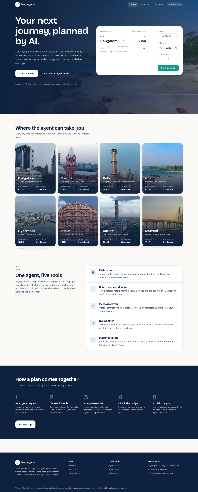
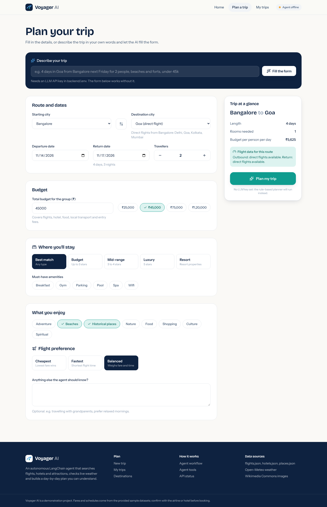
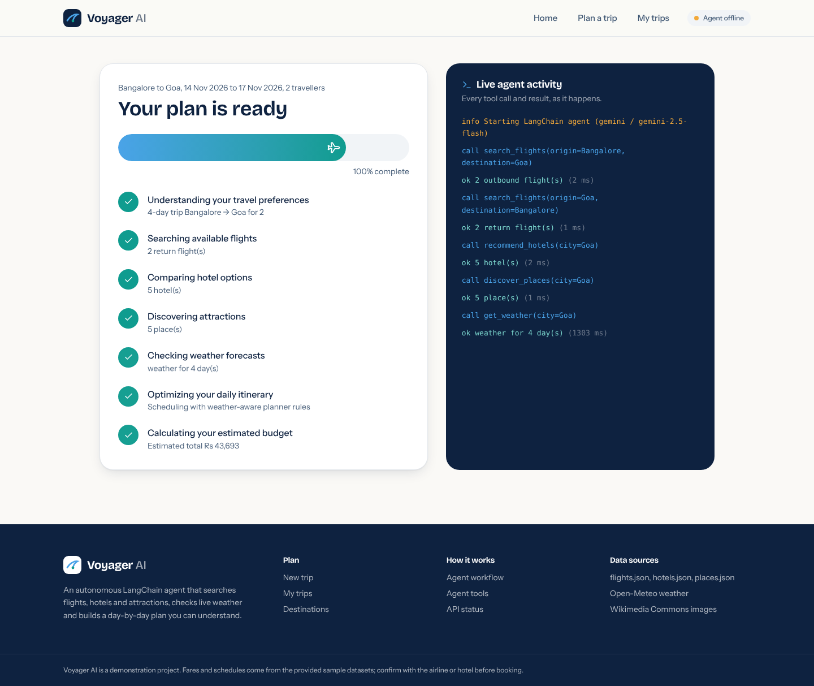
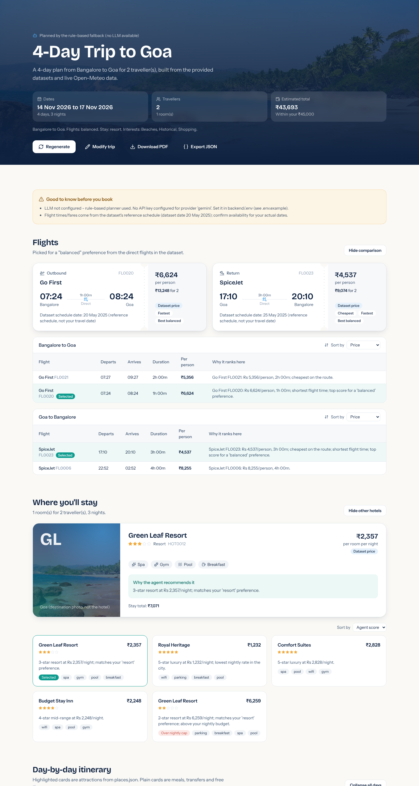

# Voyager AI — Agentic AI-Based Travel Planning Assistant Using LangChain

Voyager AI plans a 3–7 day trip end to end. A **LangChain tool-calling agent**
decides which of five tools to call — flight search, hotel recommendations,
places discovery, live weather and budget estimation — compares the results,
optimises for the traveller's budget and preferences, and returns a validated,
structured itinerary with the reasons behind every decision.

The React front end streams the agent's real progress (every tool call) while it
works, then presents the plan as a travel dashboard with flight and hotel
comparison, a day-by-day timeline, a map, weather cards, a budget chart, the
decision explanations, the full agent trace, and PDF / JSON export.

---

## Contents

1. [Problem statement](#problem-statement)
2. [Objectives](#objectives)
3. [Technology stack](#technology-stack)
4. [Architecture](#architecture)
5. [Agent workflow](#agent-workflow)
6. [Agent tools and selection logic](#agent-tools-and-selection-logic)
7. [Dataset details](#dataset-details)
8. [API integrations](#api-integrations)
9. [Project structure](#project-structure)
10. [Installation and setup](#installation-and-setup)
11. [Running the app](#running-the-app)
12. [Testing](#testing)
13. [Example trip request](#example-trip-request)
14. [REST API](#rest-api)
15. [Screenshots](#screenshots)
16. [Limitations](#limitations)

---

## Problem statement

Planning a trip means choosing flights, hotels and attractions while weighing
time, budget, weather and personal preferences. Travellers jump between sites,
compare inconsistent information and hand-build itineraries that are often
unrealistic or incomplete. Travel companies (MakeMyTrip, Booking.com,
ClearTrip, Ixigo) are moving to conversational and agentic AI to automate this.

Voyager AI is an agent that reasons like a travel expert over real data: it
retrieves options, compares them, optimises the plan and explains why.

## Objectives

**Primary**
- Agentic system built with LangChain that autonomously creates itineraries.
- Tools for flight search (`flights.json`), hotel suggestions (`hotels.json`),
  places/POIs (`places.json`) and real-time weather (Open-Meteo).
- Multi-step reasoning and decision-making via a tool-calling agent.
- Structured itineraries: day-wise plan, accommodation, weather, budget.

**Secondary**
- Filtering, ranking and optimisation (cheapest / fastest flight, best hotel
  for the stay type, budget-driven substitution).
- Decision justification ("Why your AI travel agent chose this plan").
- Output as validated JSON **and** a human-readable summary.
- A polished interface (React instead of Streamlit, for a production feel).

## Technology stack

| Layer | Technology |
| --- | --- |
| Agent | LangChain 1.x `create_agent` (tool-calling agent) + `ToolStrategy` structured output |
| LLM providers | Google Gemini (`langchain-google-genai`), OpenAI (`langchain-openai`), Groq (`langchain-groq`) — chosen via `.env` |
| Backend | Python 3.11+, FastAPI, Pydantic v2, pydantic-settings, pandas, httpx |
| Streaming | Server-Sent Events (`text/event-stream`) |
| Frontend | React 19 + Vite, Tailwind CSS v4, Framer Motion, Lucide icons, React Router, Recharts, Leaflet / React-Leaflet, jsPDF, Sonner toasts |
| External data | Open-Meteo geocoding, forecast and archive APIs (no key); Wikipedia REST API for destination photos (Wikimedia Commons) |
| Tests | pytest, FastAPI TestClient, a scripted fake tool-calling model for offline agent tests |

## Architecture

```
 React (Vite)                         FastAPI backend
 ─────────────                         ────────────────────────────────────────────
 Landing ─► Planner form ──POST /api/plan/stream──►  run_planning()
                │                                     │
                │◄──── SSE: stage / tool_start /      ├─ ToolLedger (records + emits every call)
                │       tool_end / thought / result   │
 Planning view (live stages + agent log)              ├─ LangChain agent  (create_agent)
                │                                     │     LLM decides ► search_flights
 Results dashboard ◄── TripPlan JSON                  │                  ► recommend_hotels
   flights · hotel · itinerary · map ·               │                  ► discover_places
   weather · budget · why · trace ·                  │                  ► get_weather ──► Open-Meteo
   PDF / JSON export                                  │                  ► estimate_budget
                                                      │     ► AgentPlanDraft (structured output)
                                                      │
                                                      ├─ Plan assembler (validation layer)
                                                      │     ids checked against tool results,
                                                      │     missing data fetched, budget recomputed,
                                                      │     weather attached per day
                                                      │
                                                      └─ Rule-based planner (only if no LLM / LLM error)
```

Key design decisions:

- **Per-request tools bound to a ledger.** Every tool call is timed, recorded
  and emitted as an SSE event, so the planning screen shows real progress, not
  a fake animation.
- **Anti-hallucination validation.** The LLM returns ids, not prices. The
  assembler rejects any flight/hotel/place id that the tools did not return,
  removes duplicates, fills omitted days, and recomputes the budget from
  dataset prices. Every correction is logged in the agent trace.
- **Weather fallback.** Open-Meteo is the primary source. Cloud hosts share
  outgoing IPs, which can exhaust Open-Meteo's free daily quota; then the
  forecast comes from MET Norway (api.met.no, also keyless) and each day is
  labelled with its source. Days neither source covers are shown as
  unavailable, never invented.
- **Model fallback.** If the main model fails (for example a free-tier
  rate limit, HTTP 429), the agent retries once with a lighter model
  (`gemini-3.5-flash-lite` by default, `LLM_FALLBACK_MODEL` in `.env`); the
  plan says which model made it.
- **Honest fallbacks.** No direct flight → the leg is shown as missing, with
  routes that do exist. Dates beyond the forecast window → last year's
  recorded weather, labelled "historical". No LLM key or an LLM error → a
  deterministic, clearly labelled rule-based planner that uses the same tools.

## Agent workflow

1. **Understand** – the request (cities, dates, travellers, budget, stay type,
   interests, flight preference, notes) is validated by Pydantic. The natural
   language box on the planner page uses the LLM to extract these fields and
   reports what is missing.
2. **Decide which tools to call** – the agent (system prompt in
   `backend/app/agents/prompts.py`) typically calls the two flight searches,
   hotels, places and weather in parallel.
3. **Analyse and compare** – it reads ranked results (scores, prices, stars,
   ratings, weather per day).
4. **Optimise** – it calls `estimate_budget` with its chosen ids; if over
   budget it swaps to cheaper options and re-estimates.
5. **Generate the itinerary** – one `DayDraft` per day with morning / afternoon /
   evening slots, at most two attractions per day, outdoor sights on dry days
   and indoor ones on wet days.
6. **Explain** – structured `DecisionExplanations` quoting real figures.
7. **Validate & assemble** – the plan assembler produces the final `TripPlan`
   (JSON) and a readable text summary in the format of the project brief.

## Agent tools and selection logic

| Tool | Source | What it does | Ranking / rules |
| --- | --- | --- | --- |
| `search_flights` | flights.json | Direct flights for a route; group price = per-person × travellers | Normalised price & duration weighted by preference — cheapest 85/15, fastest 15/85, balanced 50/50; +0.2 bonus for an exact date match. Tags cheapest / fastest. Empty result = explicit "no flight" note plus routes that exist. |
| `recommend_hotels` | hotels.json | Hotels in the city with rooms needed (`ceil(travellers/2)`) and stay total | Score = 0.40·stars + 0.30·value + 0.10·amenity count + 0.10·requested amenities + 0.25 type fit − 0.45 if above nightly cap. Tiers: budget ≤3★, mid-range 3–4★, luxury 5★, resort by name. |
| `discover_places` | places.json | Attractions for the city, deduplicated by name | Score = 0.6·rating/5 + 0.4·interest match. Interest → category map (e.g. historical → fort, monument, museum, temple). Entry costs are labelled estimates per category. |
| `get_weather` | Open-Meteo | Daily condition (WMO code), max/min °C, precipitation probability or mm | Geocode city → forecast for days within 16 days → ERA5 archive (then historical-forecast archive) for the same dates last year. Never invented; unavailable days are marked. |
| `estimate_budget` | ids + config | Group budget | Flights and hotel from dataset prices by id; food (₹700/1,200/2,200 per person per day, tier set by the chosen hotel's stars so every estimate agrees), local transport (₹900 per vehicle per day, 4 per vehicle) and entry fees are estimates. Each place counted once. Totals split into dataset vs estimate. |

All five tools live in `backend/app/tools/` as plain, unit-tested functions; the
LangChain `StructuredTool` wrappers and their JSON-schema argument models are in
`backend/app/tools/registry.py`.

## Dataset details

The three datasets (copied unchanged into `backend/data/`) contain:

| File | Records | Fields |
| --- | --- | --- |
| `flights.json` | 30 | flight_id, airline, from, to, departure_time, arrival_time, price (per person, INR) |
| `hotels.json` | 40 (5 per city) | hotel_id, name, city, stars, price_per_night (per room, INR), amenities |
| `places.json` | 40 (5 per city) | place_id, name, city, type, rating |

Cities: Bangalore, Chennai, Delhi, Goa, Hyderabad, Jaipur, Kolkata, Mumbai.

Observations that shaped the design:
- Flights cover only 25 directed routes and are dated in 2025, so they are used
  as each route's reference schedule and the dataset date is shown.
- Places have no coordinates, so the map pins the geocoded city only.
- Place names are generic (e.g. "Famous Park") and do not always match their
  `type`; the `type` field is treated as the category.
- Hotel names repeat across cities, so `hotel_id` is shown alongside names.

The loader (`backend/app/services/data_repository.py`) validates every record,
skips malformed ones and reports them via `/api/meta`.

## API integrations

- **Open-Meteo Geocoding** – `https://geocoding-api.open-meteo.com/v1/search`
  (country filter `IN`; aliases Bangalore → Bengaluru, Goa → Panjim).
- **Open-Meteo Forecast** – `https://api.open-meteo.com/v1/forecast`
  (`weather_code, temperature_2m_max/min, precipitation_probability_max, precipitation_sum`).
- **Open-Meteo Archive** – `https://archive-api.open-meteo.com/v1/archive`,
  with `https://historical-forecast-api.open-meteo.com/v1/forecast` as backup.
- **Wikipedia REST summary** – destination photos from Wikimedia Commons.
- **LLM** – Gemini / OpenAI / Groq through LangChain; the key stays in
  `backend/.env` and never reaches the browser.

All HTTP calls use timeouts, retries with back-off on 429/5xx, fail fast on
daily-quota errors, and cache results for 30 minutes.

## Project structure

```
travel-planner/
├── backend/
│   ├── app/
│   │   ├── main.py                 FastAPI app, CORS, error handlers
│   │   ├── config.py               Settings from .env (keys, budgets, URLs)
│   │   ├── api/routes.py           REST + SSE endpoints
│   │   ├── agents/
│   │   │   ├── travel_agent.py     LangChain agent + orchestration
│   │   │   ├── prompts.py          System prompt and parser prompt
│   │   │   ├── llm_factory.py      Gemini / OpenAI / Groq
│   │   │   ├── plan_assembler.py   Validation layer -> TripPlan
│   │   │   ├── itinerary_scheduler.py  Weather-aware scheduler
│   │   │   ├── rule_based_planner.py   Labelled fallback
│   │   │   └── query_parser.py     Natural language -> form fields
│   │   ├── tools/                  The five tools + LangChain registry
│   │   ├── services/               Datasets, weather, destination images
│   │   ├── models/schemas.py       All Pydantic models
│   │   └── utils/http.py           Resilient HTTP client
│   ├── data/                       flights.json, hotels.json, places.json
│   ├── tests/                      pytest suite (tools, agent, API)
│   ├── requirements.txt
│   ├── pytest.ini
│   └── .env.example
├── frontend/
│   ├── src/
│   │   ├── pages/                  Landing, Planner, Planning, Results, Trips
│   │   ├── components/             Ticket search, results sections, UI kit
│   │   ├── layouts/MainLayout.jsx  Navigation and footer
│   │   ├── hooks/useTrip.jsx       App state + SSE progress handling
│   │   ├── services/api.js         REST client and SSE stream parser
│   │   └── utils/                  Formatting, PDF/JSON export
│   ├── index.html
│   ├── package.json
│   └── vite.config.js              /api proxy to the backend
├── docs/
│   ├── architecture.md
│   └── screenshots/
├── start-backend.bat / start-frontend.bat   Windows helpers
├── README.md
└── .gitignore
```

Tests sit in `backend/tests/` (rather than a top-level `tests/`) so they import
the `app` package directly and run with a single `pytest` from `backend/`.

## Installation and setup

Prerequisites: **Python 3.11+**, **Node.js 20+**, an LLM API key (Gemini,
OpenAI or Groq) for the AI agent.

### 1. Backend

```powershell
cd backend
python -m venv .venv
.venv\Scripts\activate            # macOS/Linux: source .venv/bin/activate
pip install -r requirements.txt
copy .env.example .env            # macOS/Linux: cp .env.example .env
```

Edit `backend/.env` and set the provider and key, for example:

```ini
LLM_PROVIDER=gemini
GOOGLE_API_KEY=your-key-here
```

Blank lines in `.env` fall back to defaults. Note: `gemini-2.5-flash` is no
longer offered to new API keys; the default is `gemini-3.5-flash`.

(`LLM_PROVIDER=openai` + `OPENAI_API_KEY`, or `LLM_PROVIDER=groq` +
`GROQ_API_KEY` also work. Without a key the app still runs using the labelled
rule-based planner.)

### 2. Frontend

```powershell
cd frontend
npm install
```

## Running the app

Open two terminals.

**Terminal 1 – backend** (from `backend/`, venv active):

```powershell
uvicorn app.main:app --reload --port 8000
```

**Terminal 2 – frontend** (from `frontend/`):

```powershell
npm run dev
```

Open **http://localhost:5173**. API docs: http://localhost:8000/docs.
On Windows you can instead double-click `start-backend.bat` and
`start-frontend.bat` after the installation steps.

Production build of the frontend: `npm run build` (output in `frontend/dist`).

## Deployment

Backend on **Render** (free web service), frontend on **Vercel** (free).

1. Push the repository to GitHub (`backend/.env` stays local; it is in `.gitignore`).
2. **Render** → New → Blueprint → pick the repo. `render.yaml` creates the
   service (root `backend/`, start command
   `uvicorn app.main:app --host 0.0.0.0 --port $PORT`). Enter
   `GOOGLE_API_KEY` when asked; set `CORS_ORIGINS` after step 3.
3. **Vercel** → Add New Project → pick the repo → Root Directory `frontend`
   (framework Vite is detected). Add the environment variable
   `VITE_API_BASE=https://<your-render-service>.onrender.com` and deploy.
   `frontend/vercel.json` makes deep links such as `/trip/<id>` work.
4. Back on Render, set `CORS_ORIGINS=https://<your-app>.vercel.app` and
   redeploy.

The free Render instance sleeps after ~15 minutes idle; the first request
afterwards takes ~1 minute. Open `/api/health` before a demo to wake it.

## Testing

```powershell
cd backend
pytest                 # 26 offline tests: datasets, 5 tools, agent loop, validation, API, SSE
pytest -m live         # live Open-Meteo check (needs internet)
```

The agent test drives the real LangChain `create_agent` loop with a scripted
tool-calling model: it calls the real tools in parallel, then returns a draft
containing a hallucinated place id, a fake flight id, a duplicate visit and
missing days — the test asserts the validation layer catches every one.

## Example trip request

```json
POST /api/plan
{
  "origin": "Bangalore",
  "destination": "Goa",
  "departure_date": "2026-11-14",
  "return_date": "2026-11-17",
  "travelers": 2,
  "budget": 45000,
  "accommodation_type": "resort",
  "interests": ["beaches", "historical", "shopping"],
  "flight_preference": "balanced",
  "preferred_amenities": ["pool"]
}
```

Readable output (abridged, from a real run):

```
4-Day Trip to Goa (Nov 14 - Nov 17, 2026)
Flight Selected:
- Outbound: Go First FL0020 (Rs 6,624/person) - departs Bangalore at 07:24
- Return: SpiceJet FL0023 (Rs 4,537/person) - departs Goa at 17:10
Hotel Booked:
- Green Leaf Resort (Rs 2,357/night, 3-star)
Weather:
- Day 1: Clear sky (35°C)
- Day 2: Clear sky (34°C) ...
Estimated Total Budget:
- Flights: Rs 22,322
- Accommodation: Rs 7,071
- Food (est.): Rs 9,600
- Local transport (est.): Rs 2,700
- Activities (est.): Rs 2,000
Total Cost: Rs 43,693
```

Or type into the planner: *"4 days in Goa from Bangalore next Friday for 2
people, beaches and forts, under 45k"* and press **Fill the form**.

## REST API

| Method | Path | Purpose |
| --- | --- | --- |
| GET | `/api/health` | Status, LLM configuration (no secrets), dataset counts |
| GET | `/api/meta` | Cities, direct routes, enums, amenities, dataset summary |
| GET | `/api/destinations` | Destination cards with counts and Wikimedia photos |
| GET | `/api/flights`, `/api/hotels`, `/api/places`, `/api/weather` | Direct access to each tool |
| POST | `/api/parse-query` | Natural language → trip fields + missing fields |
| POST | `/api/plan` | Plan synchronously, returns `TripPlan` JSON |
| POST | `/api/plan/stream` | Plan with live SSE progress (`?rule_based=true` to force fallback) |

## Screenshots

Screenshots are in `docs/screenshots/`:

| Landing | Planner | Live planning | Results |
| --- | --- | --- | --- |
|  |  |  |  |

## Limitations

- Only direct flights on the 25 routes in `flights.json`; fares and times are
  the dataset's 2025 reference schedule, not live availability.
- With five attractions per city, longer trips include generic free-time
  slots (meals, rest) rather than invented attractions.
- Attractions have no coordinates, so the map pins the city only.
- Weather beyond 16 days is last year's record for the same dates, not a forecast.
- Food, local transport and entry fees are configurable estimates.
- Gemini's free tier allows only a few requests per minute. A full plan uses
  several model calls, so planning trips back-to-back can hit the limit; the
  app then retries with the fallback model, and as a last resort uses the
  labelled rule-based planner. Waiting a minute between plans avoids this.
- Plans are saved in the browser's local storage (no user accounts or database).
